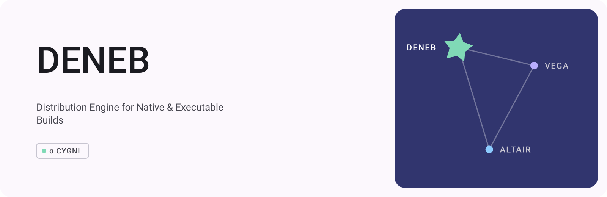

# Deneb

[English](README.md) · [简体中文](README.zh-CN.md) · [繁體中文](README.zh-TW.md) · [日本語](README.ja.md) · [한국어](README.ko.md)



**DENEB** — **D**istribution **E**ngine for **N**ative & **E**xecutable **B**uilds

Deneb builds and distributes visual novels. It reads a Vega project, checks
its resources and plugins, and creates release-ready web, PWA, desktop, and
mobile projects.

## What Deneb does

- Checks that a project, its resources, and its plugins are complete.
- Produces web builds and offline-capable PWAs.
- Creates Electron, Tauri, Android, and iOS projects.
- Fixes build inputs so the same project can be reproduced.
- Includes project-supplied external runtimes in private builds when licensed.

## Get started

```sh
cargo run --locked -p haneoka-deneb -- validate path/to/project.vega.json
cargo run --locked -p haneoka-deneb -- build path/to/project.vega.json \
  --output dist \
  --target pwa \
  --runtime-bundle ./runtime
```

Use [Altair](https://github.com/haneoka-gakuen/altair) to create and localize
the project, and [Vega](https://github.com/haneoka-gakuen/vega) to play it.

## License

Deneb is available under MPL-2.0. Third-party toolchains and runtimes retain
their own licenses.
